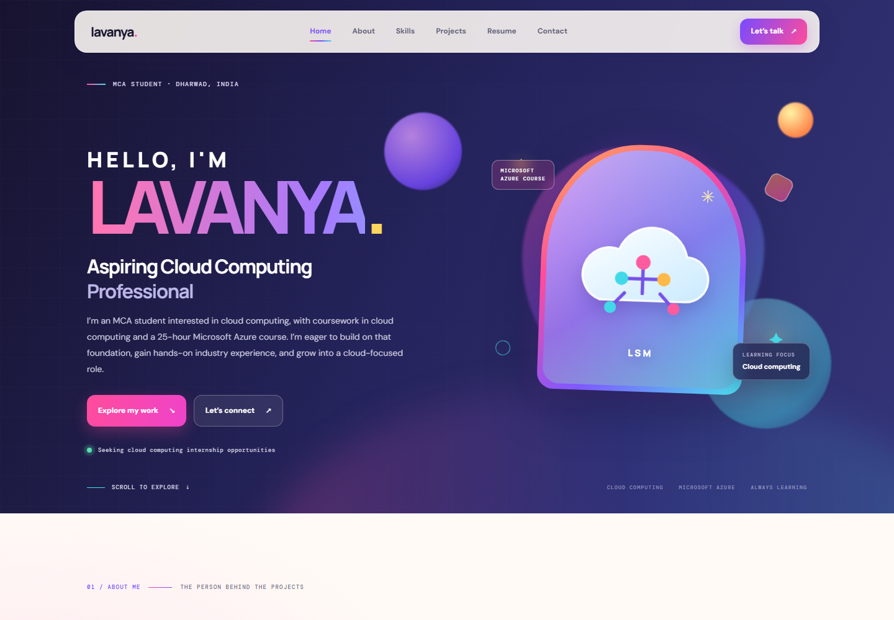

# Lavanya Portfolio

Personal portfolio website for Lavanya S Maribashetti.

## Files

```text
Portfolio_lavanya/
├── index.html
├── images/
│   └── lavanya-portrait.jpg
├── lavanya-maribashetti-resume.pdf
├── README.md
├── screenshots/
│   └── portfolio-home.png
├── css/
│   └── portfolio.css
└── js/
    └── portfolio.js
```

- `index.html` is the portfolio homepage.
- `images/lavanya-portrait.jpg` is the profile photo shown in the homepage hero.
- `css/portfolio.css` contains the page styles.
- `js/portfolio.js` contains the page interactions.
- `lavanya-maribashetti-resume.pdf` is the downloadable resume.
- `README.md` contains these project notes; it is not needed to run the website.
- `screenshots/portfolio-home.png` is a preview image of the homepage; it is not needed to run the website.

## Screenshot



Keep the HTML, CSS, JavaScript, and resume together in this folder so the relative links work.

## Run the website

Open `index.html` in a browser. Alternatively, open a terminal in this folder and run:

```powershell
py -m http.server 8000
```

Then visit <http://localhost:8000>.
